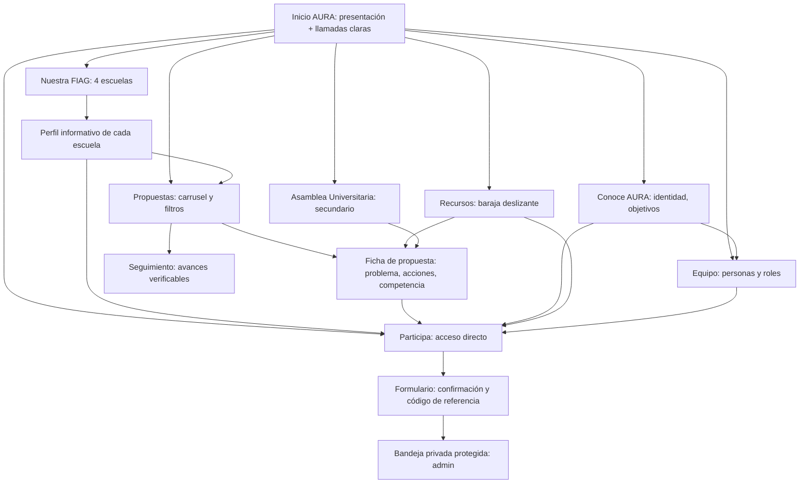

# AURA FIAG 3.0 — Plan de rediseño, flujo y especificación de implementación

> **Estado:** borrador de trabajo; NO se ha implementado en la web pública.  
> **Fecha de revisión:** 14 de octubre de 2026.  
> **Base técnica:** repositorio `ItachiTEC/aurafiag`, rama `main`, versión actual de `src/assets/app.js`, `content.js`, `styles.css`, `api/src/functions/messages.js` y `src/staticwebapp.config.json`.  
> **Prioridad institucional:** Consejo de Facultad FIAG; Asamblea Universitaria como sección complementaria y claramente diferenciada.  
> **Principio rector:** cada sección debe tener una finalidad, una acción primaria y una salida clara; evitar vueltas entre FIAG y filtros de propuestas.

## 0. Qué se decidió y qué NO

1. Cambiar las cuadrículas repetidas de **Propuestas** por un carrusel editorial navegable, con imagen si existe y una variante tipográfica potente cuando no exista.
2. Separar **Nuestra FIAG** de las propuestas: cada escuela debe tener una página propia con contenido realmente informativo, no ser otro enlace al filtro.
3. Conservar la estructura de **Conoce AURA**, pero rehacer la tipografía y el ajuste responsivo de «Ideas claras. / Canales abiertos.» para que conserve el lenguaje urbano-editorial.
4. En **Participa**, añadir CTA visible en la zona superior: «Ir al formulario», con desplazamiento y foco al formulario; mantener enlace directo a las propuestas.
5. En **Equipo**, mostrar un diseño de ficha personal con **una persona ficticia etiquetada «Demostración / No corresponde a integrante real»**, hasta recibir nombres y fotos autorizados.
6. En **Recursos**, reemplazar los tres cuadros por una **baraja de tres tarjetas**, estilo Tinder a nivel de interacción horizontal: una tarjeta protagonista y las siguientes parcialmente detrás, con botones «Anterior» y «Siguiente», indicadores, gesto táctil y accesibilidad. Mantener exactamente los tres recursos existentes al iniciar.
7. Crear navegación transversal clara entre escuela, propuestas, participación, equipo, recursos y seguimiento.
8. Incluir en el siguiente borrador las correcciones técnicas detectadas: privacidad, pruebas reales de formulario y permisos, protección antiabuso y coherencia del seguimiento.
9. **No inventar** cargos, testimonios, actas, documentos, avances ni fotografías reales de AURA.
10. **No modificar** secretos de GitHub, el recurso de Azure en producción ni las rutas públicas que ya funcionan durante la fase de diseño. Esta rama contiene solamente el plan.

## 1. Flujo de información y navegación

### Caminos principales a evaluar

- **Estudiante nuevo (0–3 clics):** Inicio → «Conoce tu escuela» → Perfil escuela → «Ver propuestas de esta escuela» o «Compartir un problema».
- **Estudiante con problema específico (0–2 clics):** Inicio/menú → Participa → CTA «Ir al formulario» → completar y enviar.
- **Estudiante que quiere comparar propuestas:** Inicio → Propuestas → elegir ámbito/escuela → deslizar propuestas → «Ver detalle».
- **Estudiante que busca soporte documental:** Propuesta → Recursos → documento oficial; siempre con opción de volver a la ficha y sin enlaces en círculos.
- **Conocer a la agrupación:** Inicio → AURA → Equipo → contacto/participación.
- **Asamblea:** acceso separado desde inicio, AURA o menú secundario, sin atribuirle acciones de Consejo.

### Navegación recomendada

Menú primario: `Inicio` · `Nuestra FIAG` · `Propuestas` · `AURA` · `Equipo` · `Recursos` · CTA `Participa`.  
En pie: `Asamblea Universitaria`, `Seguimiento`, `Privacidad`, enlaces de contacto validados.  
En móvil: menú accesible + CTA Participa persistente **solo si no tapa texto ni el botón Enviar**. No crear una barra con más opciones de las que caben.

## 2. Propuestas: carrusel editorial y contenido accesible

**Hoy:** `proposalsListing()` dibuja `#proposal-list` con `proposal-grid` y `proposalCard()`; los filtros usan `wireFilters()`. Hay 15 propuestas FIAG y 3 de Asamblea. Algunas tarjetas poseen foto pero la mayoría no.

### UX objetivo

- Mantener el encabezado, búsqueda y filtros actuales: `Consejo FIAG` / `Asamblea` / `Todas` y filtro por escuela.
- Sustituir **solo la presentación** del listado por carrusel, sin sacrificar filtros ni lectura.
- Tarjeta activa editorial grande: numeración «01 / 15», escuela, área, título, resumen de 2–3 líneas, estado, enlace «Leer propuesta» y CTA secundario «Opinar sobre esta idea».
- **Imagen opcional**: para `p.image` validada mostrar imagen con objeto visual proporcionado. Sin imagen, fondo de alto contraste y composición tipográfica prominente; **nunca imagen rota ni bloque gris vacío**. Mantener texto en HTML, no imprimir datos importantes únicamente dentro de una imagen generada.
- Mostrar parte de la tarjeta siguiente para sugerir desplazamiento. En escritorio, una grande y una fracción de siguiente (o hasta dos en ancho suficiente); en móvil, una principal.
- Controles visibles `Anterior` / `Siguiente`, puntos o contador `01 / 15`, gesto horizontal y teclas de flechas al enfocar el carrusel. La lectura vertical de la página **no debe interceptarse** por el swipe.
- Ofrecer botón «Ver como lista» / «Ver carrusel»: diseño alternativo textual compacto para accesibilidad, búsqueda rápida y comparaciones. Recordar estado de la vista en la sesión solo si se justifica; la lista debe ser funcional sin animaciones.
- Al cambiar filtro, ir a primera tarjeta, actualizar conteo, dejar claro el ámbito elegido y ofrecer estado vacío.
- La ficha de detalle existente, con `?id=...`, debe permanecer operativa y enlazar a Participa conservando la propuesta.

### Implementación

- En `src/assets/content.js` admitir propiedad opcional `image` por propuesta; el mapeo actual de fotos dentro de `proposalCard()` debe migrarse progresivamente allí, conservando un fallback tipográfico.
- En `src/assets/app.js` sustituir el contenido de `#proposal-list` por un componente reutilizable, p. ej. `renderProposalCarousel(items)` y `setupCarousel(element)`. Adaptar `wireFilters()` sin duplicar lógica.
- En `src/assets/styles.css` agregar `.aura-carousel`, `.proposal-slide`, `.proposal-slide--text`, `.carousel-controls`, reglas `scroll-snap` y `prefers-reduced-motion`.
- No recomendar librerías grandes: `scroll-snap` + JS mínimo alcanza. No utilizar autoplay.
- Considerar anchura, foco, `aria-label` de controles, orden DOM, ocultación correcta de elementos inactivos y prueba con lector de pantalla.
- Hacer que imágenes de propuesta sean descritas con `alt` pertinente; si son decorativas, `alt=""`.

### Criterios de aceptación

- Las 18 propuestas siguen disponibles y los filtros no pierden resultados.
- Un usuario puede llegar a cualquier propuesta con mouse, teclado o gesto táctil.
- Las 13 propuestas sin imagen específica siguen siendo legibles y atractivas.
- Las rutas `/propuestas/?id=...` y enlaces hacia `/participa/?tipo=comentario&propuesta=...` funcionan.
- La página no produce desplazamiento horizontal global en 360, 390, 768, 1024 y 1440 px.

## 3. Nuestra FIAG: de «bucle» a contenido auténtico

**Problema confirmado:** `schoolCard(s)` y los enlaces de `/fiag/` envían a `/propuestas/?escuela=...`. Se repite el destino del apartado Propuestas sin ofrecer un perfil informativo de la escuela.

### Nuevas páginas

- `/fiag/arquitectura/`
- `/fiag/civil/`
- `/fiag/geologica-geotecnia/`
- `/fiag/artes/`

Cada una debe presentar, en orden:

1. **Hero específico** con nombre oficial, código (verificar), resumen institucional y fotografía **real autorizada o diseño tipográfico**.
2. **Qué se estudia / cómo se aprende**: descripción breve verificable; evitar datos inventados.
3. **Experiencia académica**: talleres, laboratorios, campo o exhibiciones según contexto; usar categorías informativas, no declarar que un servicio está activo sin fuente.
4. **Necesidades que se están escuchando**: 2–3 problemas *en consulta*, con etiqueta explícita.
5. **Propuestas vinculadas**: CTA «Ver propuestas de esta escuela» → `/propuestas/?escuela=...`.
6. **Participación contextual**: CTA «Cuéntanos tu experiencia» → `/participa/?escuela=...#formulario`.
7. **Fuentes oficiales** y enlace para volver a `/fiag/`.

El index `/fiag/` se convierte en un **selector editorial de escuelas + explicación del Consejo de Facultad**; sus tarjetas ahora llevan al perfil propio y no al filtro. Los contenidos de cada perfil deben ser únicos en lo importante, no cuatro páginas clonadas de textos genéricos.

### Implementación

- Crear cuatro `src/fiag/<slug>/index.html`, siguiendo las plantillas HTML actuales y sin copiar la carpeta `dist`.
- Opción técnica recomendada: `data-page="escuela"` y `data-school="..."` en el body; agregar función `schoolDetail()` al enrutamiento de `app.js`; contenido derivado de `schools`, ampliado con `description`, `learning`, `needs`, `officialUrl`, etc.
- Modificar `schoolCard()` y los enlaces de portada (`.v2-school-line`) para que vayan a las nuevas páginas.
- Mantener el parámetro `escuela` para llegar al carrusel filtrado desde cada perfil.
- Evitar enlaces vacíos o duplicados: si falta información verificada, mostrar «Información en preparación» y no inventar.

### Criterio

Desde `/fiag/` se llega a contenido distinto del catálogo de propuestas; desde el perfil se llega tanto a propuestas como al formulario; el usuario puede volver sin quedar atrapado en círculos.

## 4. AURA: jerarquía tipográfica de «Canales abiertos»

Conservar la estructura de `about()` y sus objetivos. Revisar `.about-split h2` y el uso de `<em>`:

- Títulos: usar la misma familia visual condensada y potente de AURA 2.0 (Barlow Condensed para display), sin mezcla de cursiva serif decorativa en esa frase.
- Alternar peso o acento de color: «IDEAS CLARAS.» / «CANALES ABIERTOS.» pero con medida/espaciado coherente; mantener legibilidad en 360 px.
- Ajustar interlineado y `max-width`, evitar recortes; cuerpo con DM Sans o equivalente y contraste suficiente.
- Introducir quizá un detalle gráfico orgánico mínimo, nunca por encima del contenido.
- Comprobar en móviles y lectura con zoom 200 %.

## 5. Participa: CTA anclado al formulario

**Problema confirmado:** `formPage()` muestra una portada grande y después un formulario dentro de `.participatory-section`; no ofrece acceso inmediato con ancla desde el hero.

### Solución

- Agregar en el hero un CTA nítido «Ir al formulario ↓» con destino `#formulario`; opcional CTA secundario «Ver propuestas».
- Dar `id="formulario"` a una sección semántica donde comienza la interacción (no al botón de envío) y `tabindex="-1"` a un título descriptivo si se requiere enfocar.
- Al activar CTA: desplazar hasta el encabezado del formulario teniendo en cuenta la cabecera fija; transferir foco sin ocultar el contenido. Respetar `prefers-reduced-motion`.
- Al ingresar por vínculo directo con ancla (p. ej. `/participa/?escuela=civil#formulario`), asegurar salto después de que `app.js` haya renderizado los elementos; no depender de que el HTML inicial tenga el destino.
- Aceptar `escuela` como preselección opcional validada del formulario, sin sobrescribir la selección elegida por el usuario. Mantener `propuesta` y `tipo` como antes.
- No saltar automáticamente al campo con error ni reiniciar datos ante fallo de red.

**Criterio:** desde arriba se llega al formulario con una acción; el foco, los textos y la barra pegajosa no se superponen; enviar y visualizar confirmación siguen funcionando.

## 6. Equipo: una ficha demostrativa y estructura real

**Hoy:** `team` está vacío; `teamPage()` muestra un bloque que anuncia publicación futura.

### Diseño propuesto

- Hero «Las personas detrás de AURA».
- Galería humana menos rígida: retrato grande, nombre, escuela, función, breve descripción y ámbito `Consejo de Facultad` / `Asamblea Universitaria`.
- Un solo perfil DEMO inicial **claramente marcado**, sin atribuir nombres, fotografías ni cargos reales:
  - `name: "Integrante de ejemplo"`
  - `school: "Escuela por confirmar"`
  - `role: "Rol por confirmar"`
  - `bio: "Ficha de demostración. Será reemplazada al verificar el equipo."`
  - `photo: ""` (usar ilustración/monograma genérico, no una persona falsa identificable).
  - `isDemo: true`
- Etiqueta visible «EJEMPLO VISUAL — NO ES INTEGRANTE CONFIRMADO».
- No publicar perfiles sin consentimiento de uso de fotos y datos personales.
- Cuando se disponga de información validada, reemplazar demo por registros reales en `content.js`.

**Criterio:** página visualmente resuelta tanto con 1 demo como con 4, 8 o 12 integrantes, sin fotos estiradas ni datos inventados.

## 7. Recursos: baraja deslizante de TRES tarjetas

**Hoy:** `resources` contiene exactamente tres elementos: portal FIAG, portal UNJBG y Ley 30220. `resourcesPage()` usa `resource-grid` con tres cuadros.

### Interacción «deck»

- **Solo tres recursos iniciales**, uno activo en primer plano y dos apilados detrás; estilo editorial, no cuadrícula.
- Se puede avanzar con gesto horizontal, botón «Siguiente →», retroceder con «← Anterior» y ver el indicador `1 / 3`, `2 / 3`, `3 / 3`.
- El enlace «Abrir fuente ↗» de cada carta lleva al documento correspondiente y sigue siendo seleccionable en teclado/táctil.
- Si se llega al último, detenerse con estado claro; no desaparecer contenido sin forma de volver. Se puede reactivar el primero mediante «Volver al inicio».
- Evitar asociar swipe con eliminar o aprobar; **deslizar solo cambia el recurso activo**.
- Accesibilidad: textos HTML, teclado, `aria-live="polite"` para el indicador sin anuncios excesivos, contraste, foco visible, sin autoplay, `prefers-reduced-motion` y opción «Ver los tres como lista».
- La tarjeta apilada debe sugerir dirección, sin tapar el texto de la activa.
- Si en el futuro se agregan más recursos, que la estructura permita escalado; mantener tres en este borrador por decisión editorial.

### Implementación

- Crear componente reutilizable `renderResourceDeck(resources)` y lógica `wireResourceDeck()` en `app.js`. No mezclar con el estado del carrusel de propuestas.
- Sustituir `.resource-grid` por `.resource-deck` y estilos correspondientes.
- Mantener `resources` en `content.js` como fuente única de datos.
- Distinguir `resource.type` (Institucional, Normativa) y preservar `target="_blank" rel="noopener noreferrer"` para sitios externos.
- Las tres tarjetas pueden tener iconografía grande/fondo editorial sin exigir imágenes inexistentes.

## 8. Correcciones técnicas obligatorias antes de lanzamiento amplio

### P0 — formulario y privacidad

- Verificar manualmente `GET /api/status`, envío real `POST /api/messages`, persistencia en Azure Table Storage y lectura autorizada en `/admin/`. No presentar como comprobado lo que requiere Azure.
- Documentar responsable del tratamiento, contacto, finalidad, conservación, eliminación y ejercicio de derechos en `/privacidad/`; revisión aplicable a normativa peruana.
- Agregar defensa ante abuso: rate limiting por origen en una capa apta para Azure Static Web Apps/Functions, protección antispam robusta con verificación servidor si se usa CAPTCHA; no confiar solo en honeypot.
- No exponer connection strings ni correos de terceros; no registrar cuerpo de mensajes en logs públicos.
- Mejorar validación de payload y evitar afirmar éxito si no se guardó realmente un envío humano.
- Mantener verificación de rol `administrator` tanto en rutas como en funciones.

### P1 — bandeja y seguimiento

- Sustituir límite fijo de 300 mensajes en `adminMessages` por paginación/continuation tokens y contador conforme a lo almacenado, cuando crezca el uso.
- CSV: proteger frente a inyección de fórmulas en todas las columnas, documentar custodia y eliminación.
- La etiqueta `Respondido` no implica respuesta automática por correo: explicitarlo.
- Construir en `tracking()` estados derivados de `proposals` y referencias documentales; retirar el texto fijo «todas en consulta» cuando ya no sea cierto.
- Verificar recursos externos vigentes; no enlazar documentos hipotéticos.

### P2 — presentación y calidad

- Accesibilidad WCAG práctica: navegación y swipes con teclado, controles discernibles, zoom, contraste y movimiento reducido.
- Render HTML de propuesta y recursos sin depender de imágenes para transmitir los datos.
- Optimizar WebP, lazy-load bajo el primer pliegue y dimensiones para evitar CLS.
- SEO: títulos específicos por perfil FIAG, metadescripciones y enlaces canónicos si se incorpora dominio definitivo.
- Evitar cambios de diseño que aumenten mucho JS o requieran descargar librerías innecesarias.

## 9. Orden exacto de implementación del siguiente borrador

| Fase | Trabajo | Archivos principales | Aceptación |
|---|---|---|---|
| 0 | Crear rama de implementación y capturas actuales; acordar textos pendientes | Git / documentación | Producción intacta |
| 1 | Rehacer mapa de navegación, enlaces, retornos y CTAs | `app.js` / `content.js` | Recorridos sin bucles |
| 2 | Perfil FIAG por escuela y selector FIAG | `src/fiag/*` / `app.js` / `content.js` | 4 perfiles diferentes y rutas válidas |
| 3 | Carrusel accesible de las 18 propuestas con fallback texto | `app.js` / `styles.css` / `content.js` | Filtros, detalle y teclado funcionan |
| 4 | Ancla y foco en Participa, preselección de escuela | `app.js` / `styles.css` | Llega al formulario en una acción |
| 5 | Ajuste tipográfico AURA y layout de Equipo con demo | `app.js` / `styles.css` / `content.js` | Consistencia y sin personas ficticias sin etiqueta |
| 6 | Baraja de los 3 Recursos | `app.js` / `styles.css` | Swipe/botones/lista y enlaces |
| 7 | Seguridad, privacidad, pruebas API, seguimiento | `api/` / `app.js` / `content.js` / `privacidad` | Pruebas de flujo y datos |
| 8 | QA móvil, accesibilidad, rendimiento y despliegue de revisión | `scripts/` / workflow existente | Validaciones y revisión visual |

## 10. Pruebas que deben ejecutarse antes de fusionar a main

### Navegación

- `/fiag/` → `/fiag/arquitectura/` muestra contenido de escuela; NO abre directamente Propuestas.
- Cada perfil de escuela → `/propuestas/?escuela=ID` muestra solo los temas pertinentes.
- Propuestas: Consejo/Asamblea/Todas, buscar y elegir escuela; no se rompen conteos ni el estado del carrusel.
- Todas las fichas `?id=...` se abren y sus botones «Opinar» preservan `propuesta=...`.
- «Ir al formulario» funciona por clic normal y por URL directa con hash.
- Equipo muestra claramente una demostración sin simular personas confirmadas.
- Recursos contienen exactamente tres fuentes, permiten avanzar/retroceder y abrir sus enlaces.

### Accesibilidad / pantallas

- Teclado: `Tab`, `Shift+Tab`, `Enter`, `Space` y flechas en carruseles.
- Lectores de pantalla: nombres de controles, estados anunciados sin exceso, orden de lectura.
- Móvil 360 y 390 px, tablet 768 px, escritorio 1024 y 1440 px; sin scroll horizontal global.
- Con `prefers-reduced-motion` y sin gestos, sigue siendo completamente utilizable.
- Sin imágenes cargadas, sigue habiendo textos suficientes y enlaces funcionales.

### API

- Usuario anónimo no puede consultar ni modificar la bandeja.
- Administrador validado puede ver, cambiar estado y eliminar mensajes; pruebas con datos ficticios.
- Si Storage está caído, el formulario no afirma «recibido».
- No colocar secretos en commits. Probar rate limiting y rechazo de abuso sin perjudicar envíos legítimos.

## 11. Fuera de alcance de este borrador

- Sistema de publicaciones tipo WordPress con editor privado.
- Mensajería automática por correo y automatización de respuestas.
- Datos reales de equipo sin validación.
- Creación o compra de dominio.
- Sustituir GitHub Actions/Azure o cambiar la arquitectura sin justificación.

## 12. Entregables de la siguiente iteración

1. Web de revisión en rama separada, sin romper la producción.
2. Cuatro perfiles FIAG; carrusel de propuestas; baraja de tres recursos; CTA de Participa; tipografía AURA; maqueta de Equipo con demo.
3. Ajustes de seguridad y texto legal sometidos a aprobación para producción.
4. Pruebas `npm run check`, `npm run test`, `npm run build`, más navegación e interacción con navegador.
5. Capturas de escritorio/móvil y resumen de cambios para revisión del equipo.
6. Publicación definitiva **solo después de aprobar el borrador**, mediante Pull Request a `main`.

**Regla final:** el sitio debe permitir explorar, entender, proponer y volver, sin pantallas repetidas ni carretes que oculten información.
